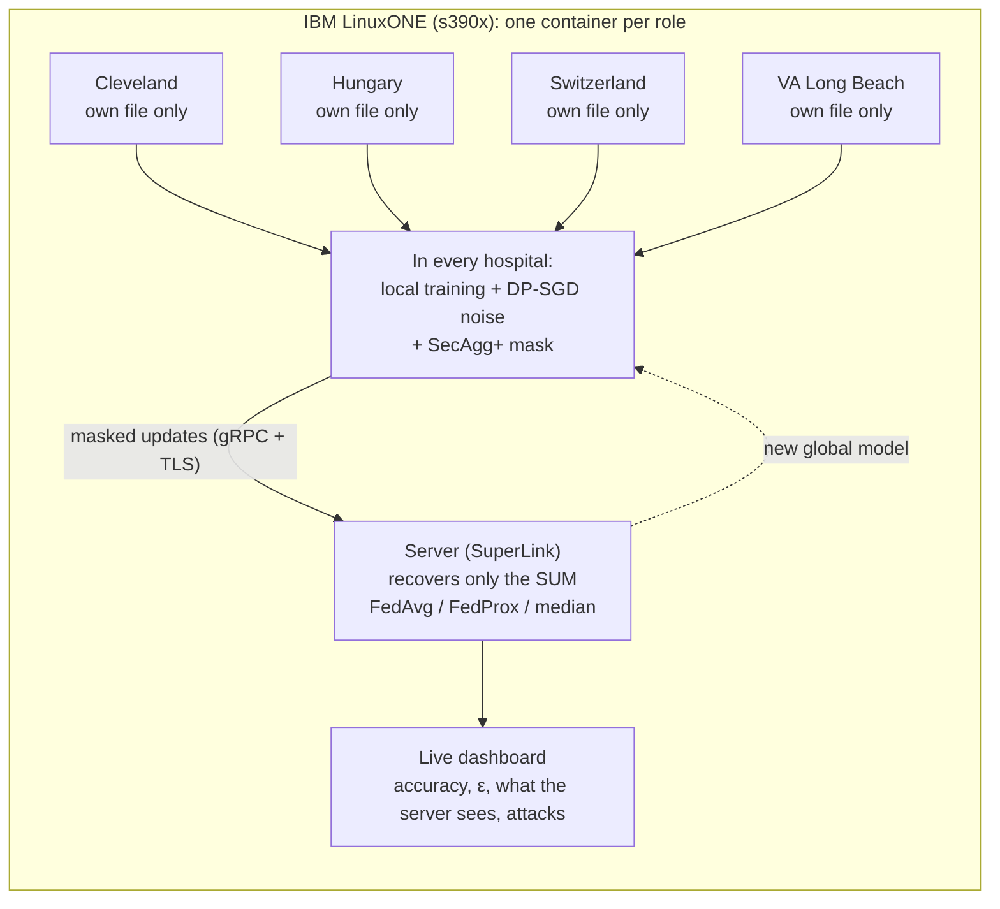

# Zero Exposure

**Four hospitals train one heart-disease model. No hospital shares a single patient record.**

Privacy-preserving federated learning on IBM LinuxONE for the IBM Z Datathon 2026, theme *AI Secured: Innovation Without Exposure*.
Each hospital trains on its own patients and sends only a noise-protected, masked model update; the server can add the updates
up but cannot read any single one. The system runs live on IBM LinuxONE (s390x) and includes an attack lab that shows what a
poisoning hospital and a curious server can and cannot do.

**Built during the event.** All code in this repository was written on 17-18 October 2026. The design and the lessons come from a
pre-event study prototype ([IBM-DATATHON](https://github.com/RitikBhardwaj-programmer/IBM-DATATHON)); no code was copied from it.

---

## Why

Hospitals cannot legally pool patient records (HIPAA, GDPR, India's DPDP Act 2023), and a small hospital that trains alone on a
few hundred patients gets a weaker, less general model. Zero Exposure lets them learn one model together while every record stays
where it is, and it measures the privacy each hospital spends.

## How it works

| Layer | Tool | What it does |
|---|---|---|
| Federated learning | [Flower](https://flower.ai) 1.37 | The model travels to each hospital; the data stays. FedAvg or FedProx combines the updates. |
| Differential privacy | [Opacus](https://opacus.ai) 1.6 (DP-SGD) | Clips each patient's influence and adds noise drawn from secret OS randomness inside each hospital; each hospital's budget ε is tracked with the RDP accountant. |
| Secure aggregation | Flower SecAgg+ | Masks each update with random values that cancel only in the sum. |
| Encrypted transport | gRPC over TLS | Every link between the server and the hospital containers is encrypted (demo CA from `deploy/gen_certs.py`). |
| Attack lab | this repo | A hospital poisons its update (label flip, boost, both); the server runs a membership-inference attack; the median of the updates is the defence. |



One `ServerApp` and one `ClientApp` (`zero_exposure/`) serve both the simulation (`python -m zero_exposure.sim`) and the real
deployment (1 SuperLink + 4 SuperNodes), so what is measured in one is what runs in the other.

Data: the public [UCI Heart Disease](https://archive.ics.uci.edu/dataset/45/heart+disease) set, which comes from four real
institutions, each kept as one federated hospital: Cleveland (303 patients), Hungary (294), Switzerland (123), VA Long Beach (200);
13 clinical features and a heart-disease label. Each hospital fills missing values and scales features with its own statistics only.

## Results

All numbers are measured in this repository (`results/*.jsonl`, 110 runs): mean ± standard deviation over 5 seeds, 20 rounds,
DP noise 1.0 unless stated. "Honest accuracy" = mean accuracy of the hospitals that are not the attacker.
Experiments use seeded training (`reproducible=1`) so runs can be repeated and compared seed by seed; real runs use secret
randomness (`reproducible=0`, the default), without which ε would be no guarantee. The noise distribution is the same either way.

**Privacy costs little accuracy**

| Setting | Global accuracy | Max ε (any hospital) |
|---|---|---|
| Centralized, all records pooled, no privacy (reference) | 0.765 ± 0.024 | none |
| Federated, no DP noise | 0.757 ± 0.025 | ∞ (no formal privacy) |
| Federated, noise 0.5 | 0.767 ± 0.015 | 166 |
| Federated, noise 1.0 | 0.763 ± 0.010 | 36.8 |
| Federated, noise 2.0 | 0.720 ± 0.031 | 12.2 |

- Federated learning with DP matches pooling all records (0.763 vs 0.765). The privacy cost shows up in ε, which is large because the
  hospitals are small (92-227 training patients): the noise is spread over few patients.
- **SecAgg+ is free in accuracy and ε:** with it on or off, every noise level gives the same mean accuracy and the same ε
  (e.g. 0.763 vs 0.762 at noise 1). It costs about 0.3-1.0 s per round in the simulation.
- FedProx (μ 0.1) does not beat FedAvg here: 0.738 ± 0.028 vs 0.763 ± 0.010.

**Attacks and the median defence** (attacker: VA)

| Attack | Honest accuracy, FedAvg + SecAgg+ | Honest accuracy, median (SecAgg+ off) |
|---|---|---|
| none | 0.765 ± 0.034 | 0.757 ± 0.026 |
| label flip | 0.723 ± 0.054 | 0.735 ± 0.027 |
| boost ×10 | 0.547 ± 0.051 | 0.713 ± 0.039 |
| label flip + boost ×10 | 0.556 ± 0.043 | 0.685 ± 0.021 |

- Boosting hurts here because the boosted update is far outside normal range: its largest value, as SecAgg+ scales it, reached 40.9
  against SecAgg+'s clipping range of 8. SecAgg+ clipped it in 42 of 100 rounds (boost) and 52 of 100 (flip + boost) and the model
  still degraded, so clipping is not a defence.
- The median recovers most of the damage, but only with SecAgg+ off: it needs every update in the clear, which SecAgg+ hides.
  The system refuses the combination rather than pretend.
- **Membership inference fails:** the loss-threshold attack (Yeom et al., 2018) on the final model scores AUC 0.51-0.53 in every
  setting, close to a coin flip (0.5), even without DP noise (0.530 ± 0.007). This small model memorises too little for the attack
  to work, so these runs cannot show what DP adds against it.

**Runs on IBM LinuxONE** (IBM LinuxONE Community Cloud, z17, 3 vCPU, 8 GB, 17 Oct 2026)
- s390x image build 16 min 31 s; full stack (certificates, SuperLink, 4 SuperNodes, dashboard) runs with TLS.
- Proof commands: `s390x`, big-endian, each hospital container holds only its own data file and only the CA certificate, 0 errors in
  the logs; the inspector's masked vector passes the uniformity test (χ² 19.8 and 27.9 < 52.2).
- Four 20-round deployment runs started from the dashboard (seed 0, noise 1.0, attacker VA), all ending with `done`:

| Run on LinuxONE | Honest accuracy | Global accuracy | Time |
|---|---|---|---|
| no attack, SecAgg+ on | 0.810 | 0.771 | 12.5 min |
| label flip, SecAgg+ on | 0.733 (the laptop simulation with the same settings: 0.733) | 0.714 | 13.0 min |
| label flip + boost, SecAgg+ on | 0.477 (SecAgg+ clipped it in 10 of 20 rounds) | 0.459 | 12.8 min |
| label flip + boost, median, SecAgg+ off | 0.689 | 0.675 | 4.3 min |

  These runs were made with seeded training, before secret randomness became the default (an independent review found that
  seeding from the public run seed voids the DP guarantee; fixed the same day). These four runs ship as dashboard replays (`dashboard/replays/linuxone_*`), and `docs/screenshots/` holds the dashboard captured
  live during them (`linuxone_*`) and replayed at the end (`replay_linuxone_*`).

**Simulation = deployment:** the deployment gives exactly the simulation's accuracy, F1, per-hospital accuracy, ε and attack results
(difference 0.0) for FedAvg, FedProx, label flip and boost + median; with SecAgg+ the aggregate stays within the quantization bound.

## Quick start

### 1. Get the data (not in git)
```bash
mkdir -p data/heart_disease && cd data/heart_disease
for h in cleveland hungarian switzerland va; do
  curl -fLO https://archive.ics.uci.edu/ml/machine-learning-databases/heart-disease/processed.$h.data
done
cd ../..
```

### 2a. Docker (amd64, or s390x on LinuxONE)
```bash
docker compose -f deploy/docker-compose.yml up --build
```
Then open http://127.0.0.1:8000 (set `DASHBOARD_PORT=8001` if the port is busy). The first start makes the TLS certificates, then
runs one SuperLink, four SuperNodes (each mounts only its own data file and only the CA certificate) and the dashboard.
On IBM LinuxONE follow [`deploy/LINUXONE.md`](deploy/LINUXONE.md).

### 2b. Python on a laptop
The simulation needs Ray. On Windows, Flower installs Ray only for Python 3.12 or older, so use Python 3.10-3.12 there.
```bash
python -m venv .venv
.venv/Scripts/python -m pip install torch --index-url https://download.pytorch.org/whl/cpu   # Linux/macOS: .venv/bin/python
.venv/Scripts/python -m pip install -r requirements.txt
```

| What | Command |
|---|---|
| Live dashboard (simulation) | `.venv/Scripts/python -m dashboard.server`, then http://127.0.0.1:8000 |
| One simulation run | `.venv/Scripts/python -m zero_exposure.sim rounds=3 secagg=1 noise=1.0` |
| With an attacker | `.venv/Scripts/python -m zero_exposure.sim rounds=3 attack=flipboost secagg=0 agg=median` |
| Real deployment, separate processes, TLS | `.venv/Scripts/python scripts/run_local_deploy.py rounds=3 secagg=1` |
| Sweeps (resumable) | `.venv/Scripts/python scripts/sweep.py all --jobs 2` |

Settings (same keys everywhere): [`CONTRACTS.md`](CONTRACTS.md) section 1. The dashboard opens with a recorded real run (the
golden replay), so every panel has data before you train.

## Tests

| Test | What it checks | Time |
|---|---|---|
| `tests/test_core_units.py` | settings and refusals, data split, byte order, ε vs the Opacus accountant, reproducible DP training, FedProx, attacks, events | ~40 s |
| `tests/test_sim.py` | contract events, same seed same result, SecAgg+ within the quantization bound, masked vector uniform, attacks, median, FedProx | ~4 min |
| `tests/test_deploy.py` | deployment == simulation exactly; SecAgg+ bound; dashboard files; TLS refuses plaintext and a foreign CA; no leftover processes | ~16 min |
| `tests/test_dashboard.py` | API contract, validation, one run at a time, live stream, inspector, stop kills the process tree, sweeps, replays, a real run | ~2 min |

`python -m pytest tests -q` (needs the data; `test_deploy.py` needs ports 9092-9097 free).

## Repository layout

| Path | Contents |
|---|---|
| `zero_exposure/` | engine: settings, data, model, DP-SGD, attacks, events, ClientApp, ServerApp, simulation entry |
| `dashboard/` | FastAPI + server-sent events + Chart.js dashboard; `replays/golden/` is a recorded real run |
| `deploy/` | Dockerfile (amd64 + s390x), compose (+ insecure and mixed-architecture overrides), TLS certificate maker, LinuxONE runbook |
| `scripts/` | native deployment launcher, sweep runner, fixture maker |
| `results/` | sweep results behind the charts and this README |
| `CONTRACTS.md` | the interfaces between the parts |

## Limits (said up front)

- **Threat model:** an honest-but-curious server (follows the protocol, tries to read updates). With 4 hospitals, 3 colluding with the
  server could reveal the 4th's update. SecAgg+ does not replace differential privacy, and ε is large because the hospitals are small.
- **Demo channels:** the server container holds all four files to compute the baselines, the pooled test score and the membership test
  (evaluation only). The dashboard's inspector (`plain.npy`) and the attack side channel hold one hospital's unmasked update, on a
  volume shared by the containers: they exist to show what SecAgg+ hides and bypass it by design. A production run sets neither.
- **TLS** uses a self-made demo CA and authenticates only the server: it encrypts the links but does not stop an unknown hospital from
  joining (Flower's `--enable-supernode-auth` with per-hospital keys would). The hospital containers share one Docker network
  with the SuperLink, so a hospital could also reach its run-control API, which has no login (separate networks or Flower user
  authentication would close this; not done). The dashboard has no login and listens on loopback only.
- **Randomness:** DP noise uses torch generators seeded with secret 64-bit values from the operating system; these are not
  cryptographic generators (Opacus `secure_mode` would be).
- **Attacks:** SecAgg+ and the median defence exclude each other, so with SecAgg+ on there is no defence against a poisoning hospital.
- **On s390x** every Flower process can crash at interpreter exit (pure-Python protobuf); the work is done by then, so a run is judged
  by its events file. The native launcher isolates hospitals by configuration only; real isolation is the container deployment.
- Not measured: more than one seed on LinuxONE, scalability beyond 4 hospitals. IBM Z features such as Secure Execution are next steps.

## Team and credits

Team **Zero Exposure**. Built with Flower, Opacus, PyTorch, FastAPI and Chart.js; fonts IBM Plex (SIL OFL). Data: Janosi,
Steinbrunn, Pfisterer and Detrano, *Heart Disease*, UCI Machine Learning Repository (1988).

## Licence

Apache License 2.0: see [`LICENSE`](LICENSE). Third-party files keep their own licences: Chart.js (MIT) and IBM Plex fonts
(SIL OFL 1.1) in `dashboard/static/vendor/`. The UCI data is not included in this repository.
